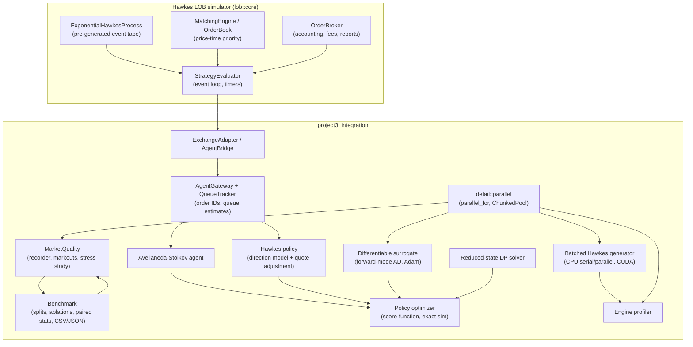

# Architecture

Project 3 is a C++20 integration and experimentation layer on top of the
Hawkes-driven limit-order-book simulator
(`../Hawkes-driven-limit-order-book-simulator.`, consumed as the CMake target
`lob::core`). It does not reimplement matching; it adds agent-facing
interfaces, policy models, analysis, benchmarking, and performance tooling.

## Component diagram

## Data flow for one simulation episode

1. `ExchangeAdapter::run` wraps the caller's `TradingAgent` in an
   `AgentBridge` (a `lob::strategy::Strategy`) and calls
   `StrategyEvaluator::run_single`.
2. The evaluator generates the full Hawkes tape
   (`ExponentialHawkesProcess::simulate_until`), merges it with timer ticks
   into a sorted timeline, and steps the matching engine, broker, and strategy
   callbacks chronologically.
3. Each market event reaches the agent as a `MarketView` value snapshot:
   book levels, best bid/ask, midprice, spread, inventory/cash, Hawkes
   intensities, open orders, and estimated queue positions. The agent never
   sees the future tape, the engine, or the RNG.
4. `OrderGateway` submissions get descending high IDs (disjoint from the
   simulator's ascending tape IDs), are tracked by `QueueTracker`, and are
   forwarded to the broker/emitter.
5. Execution notifications flow back per fill with remaining quantity and
   order status; the broker remains the accounting source of truth.

## Performance-relevant structure

- `detail::parallel_for`: index-space map over `std::thread`s with atomic
  work stealing; used for independent episode batches (benchmark, market
  quality, engine profile).
- `detail::ChunkedPool`: persistent pool (hardware-concurrency minus one
  workers plus the caller) for repeated small parallel sections; contiguous
  static chunks keep reductions deterministic. Used by the surrogate
  evaluator, which runs once per optimizer iteration.
- `batch_hawkes_kernel.hpp`: header-only Ogata-thinned exponential Hawkes
  path simulator shared verbatim by the CPU backend
  (`src/batch_hawkes.cpp`) and the CUDA backend (`src/cuda/batch_hawkes.cu`,
  one thread per path). SplitMix64 counter-based RNG gives identical streams
  on CPU and GPU.
- `QueueTracker` keeps per-order queue estimates in `std::map`s; book
  observations are merged as sorted vectors against the last depth snapshot
  (no per-event map copies).
- `AgentGateway` constructs at most one `MarketView` per strategy callback;
  the cached view is reused for the agent callback within the same context.

## Build targets

Library `project3_integration` plus examples/tests listed in
`CMakeLists.txt`. Optional `PROJECT3_ENABLE_CUDA=ON` builds the CUDA Hawkes
backend; the CPU implementation remains the numerical reference.
